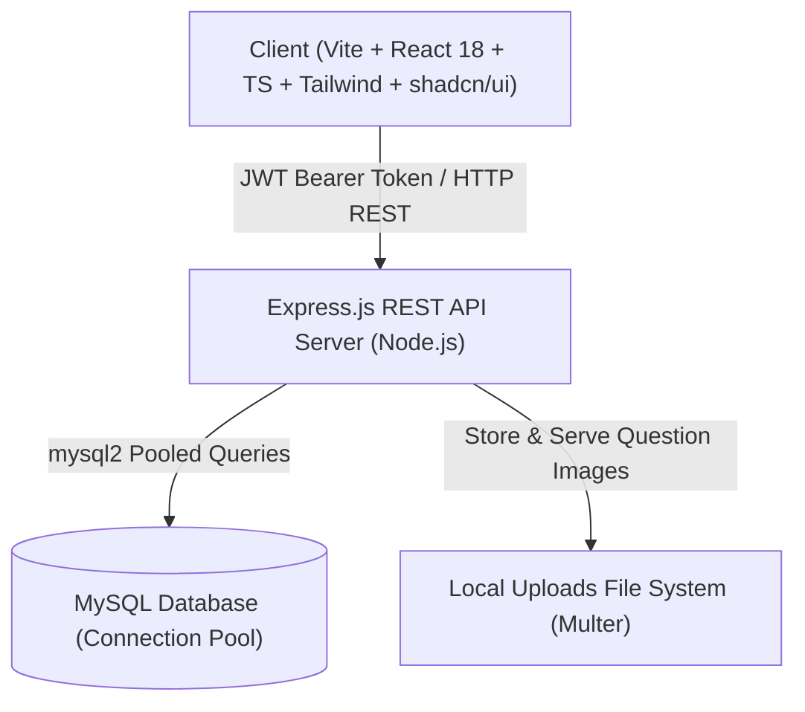

# PREP-TRACK 🎯
### Intelligent Examination & Placement Readiness Tracking Platform

> **PREP-TRACK** is a full-stack, enterprise-grade assessment, quiz, and placement preparation platform built for higher education institutions (such as **EASA College of Engineering and Technology**). It streamlines the entire examination lifecycle—from question bank curation and multi-topic test creation to secure proctored test delivery, automated grading, real-time leaderboards, and deep batch-wise analytics.

---

## 📑 Table of Contents

- [Key Highlights](#-key-highlights)
- [System Architecture](#-system-architecture)
- [Role-Based Access Control (RBAC)](#-role-based-access-control-rbac)
- [Core Features & Modules](#-core-features--modules)
  - [1. Student Assessment & Quiz Experience](#1-student-assessment--quiz-experience)
  - [2. Anti-Cheating & Proctoring Engine](#2-anti-cheating--proctoring-engine)
  - [3. Placement Mode Engine](#3-placement-mode-engine)
  - [4. Question Bank & Topic Taxonomy](#4-question-bank--topic-taxonomy)
  - [5. Faculty & HOD Dashboards](#5-faculty--hod-dashboards)
  - [6. Super Admin & Institution Analytics](#6-super-admin--institution-analytics)
  - [7. Reporting & Data Export](#7-reporting--data-export)
  - [8. Autonomous RAG AI Agent & Study Hub](#8-autonomous-rag-ai-agent--study-hub)
  - [9. Placement Intelligence, ATS Resume Scanner & Mock Interviewer](#9-placement-intelligence-ats-resume-scanner--mock-interviewer)
- [Technology Stack](#-technology-stack)
- [Project Directory Structure](#-project-directory-structure)
- [Database Schema Overview](#-database-schema-overview)
- [API Reference](#-api-reference)
- [Installation & Getting Started](#-installation--getting-started)
  - [Prerequisites](#prerequisites)
  - [1. Database Setup](#1-database-setup)
  - [2. Server Setup](#2-server-setup)
  - [3. Client Setup](#3-client-setup)
- [Environment Configuration](#-environment-configuration)
- [Contributing & License](#-contributing--license)

---

## ✨ Key Highlights

- 🛡️ **Built-in Proctoring & Security**: Fullscreen lock, shortcut blocking (DevTools, PrintScreen, Alt+Tab), tab-switch breach tracker, and auto-submission on session expiry.
- 🎯 **Dual Test Tracks**: Supports both **Curricular Regular Tests** (department-level subject tests) and **Campus Placement Drives** (aptitude, soft skills, coding, reasoning).
- 👥 **Multi-Tiered Roles**: Tailored portals for **Students**, **Faculty**, **Heads of Departments (HOD)**, **Vice Principals (Admin)**, and **Principals (Super Admin)**.
- 📊 **Rich Analytics**: Visualized with Recharts, providing test-score distributions, batch averages, individual trajectory graphs, and question-level difficulty breakdowns.
- 📥 **Batch Operations**: Bulk CSV import and export capabilities for student rosters, faculty records, and question sets with sample template downloads.
- 📑 **Export Capabilities**: Dynamic client-side generation of PDF reports via `jsPDF` / `jspdf-autotable` and Excel exports via `xlsx`.

---

## 🏛️ System Architecture



---

## 🔐 Role-Based Access Control (RBAC)

The system enforces strict permission boundaries based on user roles:

| Role ID | Role Name | System Alias | Capabilities |
| :---: | :--- | :--- | :--- |
| **1** | **Student** | `student` | Take scheduled & placement tests, view personal test analytics, review test history, check global/department leaderboards. |
| **2** | **Faculty** | `faculty` | Build & assign tests, upload questions (manual / CSV), view live test progress, evaluate student attempts, generate test reports. |
| **3** | **HOD** | `hod` | Department-wide oversight, manage departmental faculty & students (add/edit/bulk import/password reset), view department analytics. |
| **4** | **Vice Principal** | `admin` | Institution-level operations across all departments, batch student/staff roster management, centralized question bank overview. |
| **5** | **Principal** | `super-admin` | Platform-wide control, department CRUD, institute-wide metrics, cross-department test creation & analytics reports. |

---

## 🚀 Core Features & Modules

### 1. Student Assessment & Quiz Experience
- **Test Hub**: Filter available, in-progress, and completed tests categorized by subject, topic, duration, and faculty.
- **Dynamic Navigation**: Clean interface showing answered, unanswered, marked for review, and skipped questions.
- **Immediate Feedback**: Instant scorecard upon submission with total score, percentage, correct/incorrect answer breakdowns, and question-by-question review.

### 2. Anti-Cheating & Proctoring Engine
- **Fullscreen Enforcement**: Requires tests to be completed in fullscreen; tracks exits.
- **Shortcut & DevTool Prevention**: Suppresses keys such as `F12`, `Ctrl+Shift+I/J/C`, `Ctrl+U`, `PrintScreen`, `Escape`, `Windows/Meta`, and `Alt+Tab`.
- **Tab & Window Switch Tracking**: Monitors window blur and visibility changes, logging security breaches and auto-terminating if breaches exceed threshold.
- **Strict Countdown Timer**: Real-time timer with automatic test submission upon expiration.

### 3. Placement Mode Engine
- Special training tracks geared for competitive corporate placement drives.
- Categorized test modules for Quantitative Aptitude, Logical Reasoning, Verbal Ability, and Technical Domain Quizzes.
- Specialized analytics measuring corporate test readiness and competitive percentile benchmarking.

### 4. Question Bank & Topic Taxonomy
- Hierarchical structure: **Domain / Topic** ➔ **Subtopic** ➔ **Questions**.
- Multiple Choice Questions (MCQs) with options A, B, C, D, customizable mark allocation, and image attachment support via Multer.
- CSV Question Upload Wizard with built-in format validator and downloadable sample template.

### 5. Faculty & HOD Dashboards
- **Test Creation Wizard**: Define test duration, time slots, target department, academic year, and questions selection.
- **Live Monitoring**: Track students actively taking tests in real-time.
- **Student & Staff Management**: HODs can directly add faculty and students, reset forgotten credentials, and upload batch spreadsheets.

### 6. Super Admin & Institution Analytics
- Macro-level overview: Total registered students, active faculty, overall quiz participation rates, and average institutional score.
- Departmental comparative ranking and performance breakdown.
- Global department creation, editing, and allocation.

### 7. Reporting & Data Export
- Export student rosters and score sheets directly to `.csv` or `.xlsx`.
- Instant PDF report generation summarizing student performance cards and batch scorecards via `jspdf`.

---

## 💻 Technology Stack

### Frontend (`/client`)
- **Framework**: React 18 with TypeScript
- **Bundler & Tooling**: Vite with `@vitejs/plugin-react-swc`
- **Styling**: Tailwind CSS, PostCSS, `clsx`, `tailwind-merge`, `tailwindcss-animate`
- **UI Components**: shadcn/ui components powered by Radix UI primitives
- **Icons**: Lucide React
- **Data Visualization**: Recharts (Line charts, Bar charts, Area charts)
- **State Management & Querying**: TanStack React Query v5, Context API
- **Form Management**: React Hook Form, Zod
- **Notifications**: React Hot Toast, Sonner
- **Document & Spreadsheet Export**: `jspdf`, `jspdf-autotable`, `xlsx`
- **Routing**: React Router DOM v6

### Backend (`/server`)
- **Runtime**: Node.js
- **Web Framework**: Express.js (v5)
- **Database Engine**: MySQL with `mysql2` connection pooling
- **Authentication**: JSON Web Tokens (`jsonwebtoken`), `bcryptjs` for secure password hashing
- **File Uploads**: `multer` with disk storage and file validation
- **Environment**: `dotenv`

---

## 📂 Project Directory Structure

```text
PREP-TRACK/
├── client/                                 # Frontend Vite + React application
│   ├── public/                             # Static public assets
│   ├── src/
│   │   ├── assets/                         # Logos, banners, institution branding
│   │   ├── components/
│   │   │   ├── auth/                       # AuthContext, LoginForm, ProtectedRoute
│   │   │   ├── dashboard/                  # Dashboards for all user tiers
│   │   │   │   ├── faculty/                # Faculty test, topic, and management components
│   │   │   │   ├── hod/                    # HOD staff and student management
│   │   │   │   ├── student/                # Student header, stats, and reports
│   │   │   │   ├── PlacementAdminUI.tsx    # Placement test administration
│   │   │   │   ├── PlacementModeUI.tsx     # Student placement mode view
│   │   │   │   ├── ReportsSectionUI.tsx    # In-depth test & student reporting
│   │   │   │   ├── StudentDashboard.tsx    # Main student portal
│   │   │   │   ├── faculty-dashboard.tsx   # Main faculty portal
│   │   │   │   └── hod-dashboard.tsx       # Main HOD portal
│   │   │   ├── layout/                     # SidebarLayout and responsive frames
│   │   │   ├── leaderboard/                # Global and department leaderboard
│   │   │   ├── quiz/                       # QuizInterface with anti-cheating engine
│   │   │   └── ui/                         # shadcn/ui component library
│   │   ├── hooks/                          # Custom React hooks (toast, mobile detection)
│   │   ├── lib/                            # API fetchers, token helpers, utils
│   │   ├── pages/                          # Routed view pages (Admin, HOD, Student, Quiz)
│   │   ├── App.tsx                         # Route configuration and providers
│   │   └── main.tsx                        # Application mount
│   ├── package.json
│   ├── tailwind.config.ts
│   └── vite.config.ts
│
├── server/                                 # Backend REST API server
│   ├── config/
│   │   ├── conn.js                         # MySQL connection pool configuration
│   │   └── backup/
│   │       └── preptrack.sql               # Database schema & initial seed data
│   ├── controllers/                        # Business logic handlers
│   │   ├── authController.js               # Login, signup, user verification
│   │   ├── deptController.js               # Department CRUD
│   │   ├── leaderboardController.js        # Leaderboard calculation & rank retrieval
│   │   ├── QuestionController.js           # Question bank management & image uploads
│   │   ├── quizFunction.js                 # Quiz sessions, answer recording, grading
│   │   ├── staffReportController.js        # Faculty and HOD analytical reports
│   │   ├── superadminController.js         # Institute-wide metrics & master controls
│   │   ├── testController.js               # Test scheduling, assignment, questions mapping
│   │   ├── topicController.js              # Topic and subtopic hierarchies
│   │   └── userController.js               # Student & Faculty user management
│   ├── middleware/
│   │   └── authMiddleware.js               # JWT authentication & claims parsing
│   ├── routes/                             # API route definitions
│   │   ├── auth.js
│   │   ├── dept.js
│   │   ├── leaderboard.js
│   │   ├── question.js
│   │   ├── quiz.js
│   │   ├── staffReports.js
│   │   ├── test.js
│   │   ├── topic.js
│   │   └── user.js
│   ├── uploads/                            # Stored question media
│   ├── migrate.js                          # Database schema migration script
│   ├── package.json
│   └── server.js                           # Express entry point & CORS configuration
│
└── README.md                               # Project documentation
```

---

## 🗄️ Database Schema Overview

The database is built on relational integrity in MySQL. Key tables include:

- `users`: User records with columns `roll_no`, `name`, `email`, `password`, `department_id`, `role_id`, and `year`.
- `roles`: Defines user types (`student`, `faculty`, `hod`, `vice_principal`, `super-admin`).
- `departments`: Academic branches (`dept_id`, `name`, `short_name`).
- `topics` & `sub_topics`: Subject matter taxonomy, tagged by `regular` or `placement` track.
- `questions`: Question text, options `option_a` through `option_d`, `correct_option`, `mark`, and optional `image_path`.
- `tests`: Test configuration (`title`, `duration_minutes`, `num_questions`, `date`, `time_slot`, `is_active`, `type`).
- `test_questions`: Many-to-many relationship mapping tests to assigned questions.
- `student_tests`: Tracks student attempts, statuses (`started`, `completed`), scores, and timestamps.
- `student_answers`: Stores individual question responses and whether they were correct.
- `leaderboard`: Historical performance points and standings.

---

## 🔌 API Reference

### Auth (`/api/auth`)
- `GET /user/:rollNo` - Retrieve user profile information by roll number.
- `POST /signup` - Register a student or staff account.
- `POST /login` - Authenticate user credentials and return a signed JWT.
- `PUT /profile` - Update current user profile details *(Protected)*.
- `PUT /reset-password` - Update password credentials *(Protected)*.

### Tests & Placement (`/api/test`)
- `GET /` - List tests created by the authenticated faculty member.
- `GET /student/available` - Fetch active tests assigned to student's department and year.
- `GET /student/placement` - Fetch active placement preparation tests.
- `GET /:test_id` - Fetch test details and metadata.
- `POST /` - Create a new test.
- `PUT /:test_id` - Update existing test details.
- `DELETE /:test_id` - Remove a test.
- `PUT /:test_id/toggle-status` - Activate or deactivate test.
- `POST /:test_id/assign-questions` - Link questions from subtopics into a test.

### Quiz Execution (`/api/quiz`)
- `GET /:testId/questions` - Retrieve test questions for an active session.
- `POST /:testId/start` - Initialize student test attempt.
- `POST /answer` - Save individual question response in real time.
- `POST /submit` - Finalize test attempt, compute final score, and record answers.

### Reports & Analytics (`/api/reports`)
- `GET /students` - Retrieve student list under a faculty member.
- `GET /student/:studentId` - Fetch detailed performance profile of a specific student.
- `GET /test-analysis/:testId` - Test-level score distribution and statistics.
- `GET /department-report` - Departmental aggregate performance.
- `GET /live-tests` - In-progress test sessions and active test takers.
- `GET /dashboard-stats` - Faculty summary metrics.

### Question Bank (`/api/question`)
- `GET /topics` - Retrieve all topics.
- `GET /sub-topics-with-questions` - Retrieve subtopics with nested question details.
- `PUT /addquestions` - Add a question (supports multipart image file).
- `PUT /update/:question_id` - Modify question details or option keys.

### Users & Administration (`/api/users`)
- `GET /list` - Fetch all students.
- `POST /upload` - Bulk student registration via CSV.
- `GET /faculty-list` - Retrieve faculty list.
- `GET /department-staff` - Retrieve department staff for HOD *(Protected)*.
- `GET /department-students` - Retrieve department students for HOD *(Protected)*.

### Autonomous RAG Agent & Study Hub (`/api/rag`)
- `POST /upload` - Ingest syllabus or question paper (PDF/TXT, extracts text & BM25 chunks).
- `GET /documents` - List all uploaded documents for current session.
- `DELETE /documents` - Clear current session material.
- `POST /chat` - Grounded doubt clearing chatbot with page-level citations.
- `POST /generate-quiz` - Generate grounded practice quiz from coursework with optional saving to My Tests.
- `POST /flashcards` - Synthesize smart flashcards with front/back keyword prompts.
- `POST /cheat-sheet` - Generate condensed markdown exam revision cheat sheet.
- `GET /agent/capabilities` - Inspect RAG agent personas, architecture, and available tools.
- `POST /agent/interact` - ReAct multi-step autonomous agent deliberation with reasoning steps and citations.

### Placement & AI ML Intelligence (`/api/ml`)
- `POST /predict-placement` - Tier 1/2/3 placement probability prediction and salary estimation.
- `POST /diagnose-weak-areas` - Adaptive diagnostic assessment identifying weak conceptual areas.
- `POST /forecast-score` - Performance trajectory forecasting.
- `POST /scan-resume` - ATS resume scanner with score (0-100), placement match, and keyword analysis.
- `POST /mock-interview/generate-question` - Generate technical CS or HR mock interview question.
- `POST /mock-interview/evaluate-response` - Rubric-based scoring (1-10) with model answer and improvement tips.

---

## 🛠️ Installation & Getting Started

### Prerequisites
- [Node.js](https://nodejs.org/) (v18.0.0 or higher recommended)
- [MySQL Server](https://dev.mysql.com/downloads/mysql/) (v8.0+ or compatible MariaDB)
- `npm` or `bun` package manager

---

### 1. Database Setup
1. Start your local MySQL service.
2. Create the target database (e.g. `preptrack`):
   ```sql
   CREATE DATABASE preptrack;
   ```
3. Import the initial database schema and seed data located at `server/config/backup/preptrack.sql`:
   ```bash
   mysql -u root -p preptrack < server/config/backup/preptrack.sql
   ```
4. Run migrations if necessary:
   ```bash
   cd server
   node migrate.js
   ```

---

### 2. Server Setup
1. Navigate to the `server` directory:
   ```bash
   cd server
   ```
2. Install dependencies:
   ```bash
   npm install
   ```
3. Create your `.env` configuration file in `server/.env`:
   ```env
   PORT=5000
   DB_HOST=127.0.0.1
   DB_PORT=3306
   DB_NAME=preptrack
   DB_USER=root
   DB_PASSWORD=your_mysql_password
   JWT_SECRET=your_super_secret_jwt_key
   ```
4. Start the backend development server:
   ```bash
   npm run dev
   ```
   *The server will start on `http://localhost:5000`.*

---

### 3. Client Setup
1. Open a new terminal and navigate to the `client` directory:
   ```bash
   cd client
   ```
2. Install frontend dependencies:
   ```bash
   npm install
   ```
3. Create your `.env` configuration file in `client/.env`:
   ```env
   VITE_API_BASE=http://localhost:5000/api
   ```
4. Start the Vite development server:
   ```bash
   npm run dev
   ```
5. Open your browser and navigate to `http://localhost:5173`.

---

## ⚙️ Environment Configuration

### Server Environment (`server/.env`)
| Variable | Description | Default |
| :--- | :--- | :--- |
| `PORT` | Port for Express API server | `5000` |
| `DB_HOST` | MySQL hostname or IP address | `127.0.0.1` |
| `DB_PORT` | MySQL connection port | `3306` |
| `DB_NAME` | Database name | `preptrack` |
| `DB_USER` | MySQL database username | `root` |
| `DB_PASSWORD` | MySQL database password | `root` |
| `JWT_SECRET` | Secret key for signing session tokens | `123` |

### Client Environment (`client/.env`)
| Variable | Description | Default |
| :--- | :--- | :--- |
| `VITE_API_BASE` | Base URL pointing to the Express `/api` endpoint | `http://localhost:5000/api` |

---

## 👥 Default Demo Credentials & Roles

The system seed database includes pre-configured access tiers:

| Role | Roll / ID | Permissions |
| :--- | :--- | :--- |
| **Student** | Student Roll No | Access student assessment portal & placement drive tests |
| **Faculty** | Faculty Staff ID | Create quizzes, view reports, manage test questions |
| **HOD** | Department ID | Manage department faculty & students, department analytics |
| **Vice Principal** | Admin ID | Cross-department test & user administration |
| **Principal** | Super Admin ID | Global platform metrics, institution controls |

---

## 👨‍💻 Author & Maintainer

- **Lead Developer**: **Lokesh (lokesh-gojo)**
- **GitHub**: [@lokesh-gojo](https://github.com/lokesh-gojo)
- **Email**: [lokesh2005c@gmail.com](mailto:lokesh2005c@gmail.com)
- **Project**: **PREP-TRACK** — Intelligent Examination, Placement Readiness & Autonomous RAG AI Platform

---

## 📄 License
This project is proprietary academic software developed for **EASA College of Engineering and Technology**. All rights reserved.
